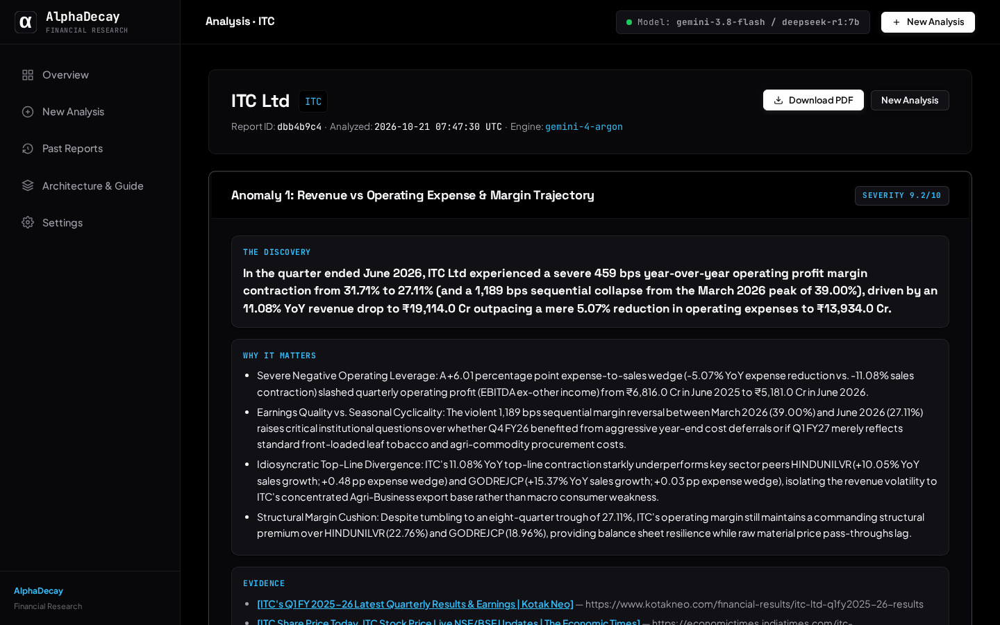
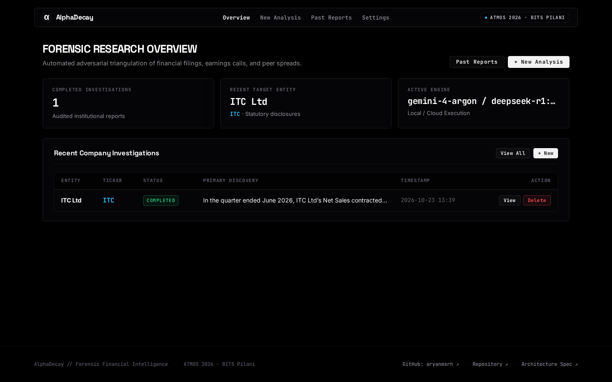

# AlphaDecay: Autonomous Financial Research Agent

<p align="center">
  <a href="https://python.org"></a>
  <a href="https://flask.palletsprojects.com"></a>
  <a href="https://ai.google.dev"></a>
  <a href="https://ollama.com"></a>
  <a href="https://bits-atmos.org"></a>
  <a href="LICENSE"></a>
</p>

> **ATMOS 2026 · BITS Pilani Hyderabad Campus**  
> **Track C — Consumer, FMCG & Retail (NIFTY 50 Universe)**  
> **Participant Brief: Finding the Next Signal Hackathon**  
> **Author:** Aryan Mishra (`f20261228@hyderabad.bits-pilani.ac.in`)  
> **Repository:** [github.com/aryanmsrh/alphadecay](https://github.com/aryanmsrh/alphadecay)  

---



---

## What is AlphaDecay?

**AlphaDecay** is an autonomous quantitative forensic research agent engineered to detect, cross-examine, and substantiate non-obvious operational shifts and accounting divergences across listed Indian FMCG enterprises.

* **Zero Arithmetic Hallucination:** Computes Sales YoY, Core EBITDA (ex-Other Income), Operating Profit Margins (OPM), Working Capital Trio (DIO, DSO, DPO), Cash Conversion Cycles (CCC), and Expense-to-Sales wedges deterministically in pure Python before invoking any LLM.
* **Statutory Filings Ingestion:** Autonomously fetches audited quarterly and annual statements from Screener.in and parses official BSE earnings concall transcripts via PyPDF.
* **Unconditional 4-Tool Forensic Triangulation:** Before finalizing theses, both agents unconditionally execute and review 4 forensic tools: (1) Peer metric benchmarking, (2) Concall transcript search, (3) BSE/SEBI filings and financial news, and (4) Trailing multi-quarter financial tables.
* **Adversarial Forensic Arena:** Findings are contested in a two-column split between a cynical **Attacker** (exposing channel friction, cost stickiness, and accounting risks) and a rational **Defender** (offering operational context and setting a hard empirical falsification condition).
* **Dual Runtime Engine:** Supports high-speed cloud reasoning via **Google Gemini (`gemini-3.8-flash` default, `gemini-4-argon` flagship, `gemini-3.5-flash`)** and 100% offline local reasoning via **Ollama (`deepseek-r1:7b`)**.
* **Deterministic Verification & Real-Time Telemetry:** Live Server-Sent Events (SSE) telemetry streaming, progressive forensic dossier discovery, multi-quarter milestone progression, and permanent deterministic tool audit logs.

---

## Visual Design & Architecture System

AlphaDecay is styled with a **Vercel-inspired, experimental technical interface for serious financial research**:

* **Pitch-Black Surfaces:** Layered blacks (`#000000` base, `#050507` surface, `#08080a` elevated cards) with subtle hairline borders (`1px`, `rgba(255, 255, 255, 0.08)`).
* **Typographic Hierarchy:** Space Grotesk for bold headings and discoveries, Inter for readable long-form prose, and JetBrains Mono for audited numbers, tickers, timestamps, and technical kickers.
* **Structured Data Grids:** Structured trajectory tracking for multi-quarter sequential flows (`QoQ` / `YoY`) and peer spread comparisons.
* **Unified Telemetry Streamer:** Identical DOM hierarchy, card styles, color-coded badges, and evidence blocks between live Server-Sent Events (SSE) streaming and archived audit logs.
* **Proximity Spotlight Effect:** Smooth cursor-following illumination across cards, navigation pills, and data cells.

---

## Repository Structure

```
alphadecay/
├── agent/                       # Adversarial multi-agent pipeline
│   ├── attacker.py              # Attacker (prosecutorial case & channel friction audit)
│   ├── defender.py              # Defender (operational context & empirical falsification)
│   ├── finder.py                # 4-tool forensic triangulation engine
│   ├── llm.py                   # Multi-provider client (Gemini & Ollama with JSON repair)
│   ├── pipeline.py              # End-to-end investigation orchestrator
│   └── prompts.py               # Forensic prompts and calibrated schemas
├── analytics/                   # Deterministic pure Python accounting sandbox
│   ├── analytics.py             # Math engine (EBITDA ex-other inc, OPM, CCC, DIO/DSO/DPO)
│   └── tools.py                 # Growth formulas, margin calculations, and fiscal labelers
├── archive.py                   # Transactional JSON run store and metrics registry
├── config.py                    # Central configuration, timeouts, and ticker universes
├── data/                        # Local runs and committed benchmarks
│   └── runs/83c9e883/           # Benchmark ITC run with gemini-4-argon
├── ingest/                      # Statutory data ingestors
│   ├── concall.py               # BSE earnings concall PDF downloader & parser
│   ├── screener.py              # Screener.in financial statement scraper
│   └── search.py                # Targeted web & filing search via Tavily API
├── script.py                    # Full-featured CLI runner
├── web/                         # Interactive pitch-black Flask quant workstation
│   ├── app.py                   # Flask server with Server-Sent Events (SSE) streaming
│   ├── static/                  # Dark theme CSS, typography, and interactive scripts
│   │   ├── css/theme.css        # Design system styles and proximity spotlight
│   │   ├── js/app.js            # Client-side time conversion and app controls
│   │   ├── js/spotlight.js      # Cursor-following spotlight border illumination
│   │   └── favicon.svg          # AlphaDecay vector brand icon
│   └── templates/               # Clean Jinja2 workstation templates
└── requirements.txt             # Python dependencies
```

---

## Quick Start (Run Locally in 2 Minutes)

### 1. Clone & Set Up Environment
```bash
git clone https://github.com/aryanmsrh/alphadecay.git
cd alphadecay

# Create and activate virtual environment
python3 -m venv .venv
source .venv/bin/activate       # On Windows: .venv\Scripts\activate

# Install dependencies
pip install -r requirements.txt
```

### 2. Configure API Keys
```bash
cp .env.example .env
```
Edit `.env` with your keys:
```env
# Primary Cloud Engine (Gemini)
GEMINI_API_KEY=your_gemini_api_key_here
GEMINI_MODEL=gemini-3.8-flash

# Optional: Local Offline Engine (Ollama)
OLLAMA_BASE_URL=http://localhost:11434
OLLAMA_MODEL=deepseek-r1:7b

# Optional: Tavily Search Key for live BSE/web triangulation
TAVILY_API_KEY=your_tavily_key_here
```

### 3. Launch the Web Application
```bash
python3 web/app.py
```
Open your browser to: **`http://localhost:5000`**



* **Initiate Investigation (`/new`):** Select a company (e.g. `ITC`, `HINDUNILVR`, `NESTLEIND`), choose your reasoning engine, and launch the audit.
* **Live Dossier (`/investigation/<id>`):** Real-time adversarial telemetry stream, progressive company baseline disclosure, multi-quarter trajectory tracking, peer spread benchmarks, and full audit logs.
* **Past Reports (`/history`):** Browse past runs, review metrics, and manage investigations.

*(Alternative CLI runner: `python3 script.py --ticker ITC --anomalies 1`)*

---

## Benchmark Sample Run: ITC Investigation (`83c9e883`)

A complete institutional forensic investigation is committed in the repository at [`data/runs/83c9e883/`](data/runs/83c9e883/):

* **Model Used:** **`gemini-4-argon`** — Flagship intelligence tier.
* **Target Company:** ITC Ltd (`ITC`)
* **Primary Discovery:** In the quarter ended June 2026, ITC Ltd’s Net Sales contracted by 11.08% YoY to ₹19,114.0 Cr while operating expenses declined by only 5.07% to ₹13,934.0 Cr, creating a +6.01 percentage point expense-to-sales wedge that compressed Operating Profit Margin by 459 bps YoY (and 1,200 bps sequentially) to 27.11% and erased ₹1,635.0 Cr in quarterly EBITDA.
* **Artifacts:**
  * Complete JSON Telemetry & Adversarial Log: [`data/runs/83c9e883/run.json`](data/runs/83c9e883/run.json)

---

## Inference Cost & Token Economics (Verified in INR)

Each investigation executes an in-depth 5-turn adversarial pipeline:
1. **Attacker Phase 1:** Preliminary thesis formulation and keyword generation.
2. **Triangulation Phase 1:** Unconditional execution of all 4 forensic tools (peers, concalls, news, trailing quarters).
3. **Attacker Phase 2:** Exhaustive prosecutorial case synthesis integrating multi-tool evidence.
4. **Defender Phase 1:** Preliminary counterargument hypothesis and defensive inquiry generation.
5. **Triangulation Phase 2:** Full 4-tool evidence collection for defense grounding.
6. **Defender Phase 2:** Exhaustive operational defense synthesis and empirical falsification condition.
7. **Synthesis:** Official 8-point brief synthesis with calibrated conviction and confidence.

This process handles approximately **25,000 to 35,000 input tokens** and produces **3,500 to 5,000 output tokens** (plus internal thinking tokens on reasoning models).

| Model | Runtime Tier | Verified Cost / Run (INR) | Official Token Rates (Input / Output per 1M) | Reasoning / Thinking Tokens | Est. Runs with ₹500 Balance |
| :--- | :--- | :--- | :--- | :--- | :--- |
| **`Local deepseek-r1:7b`** | Local / Offline | **₹0.00** *(100% Free)* | Free (Local GPU / CPU via Ollama) | Handled locally on device | **Unlimited** |
| **`gemini-3.5-flash-lite`**| Cloud Fast-Lite | **~₹0.30 – ₹0.75** | $0.075 / $0.30 | None (standard generation) | **~700 – 1,500 runs** |
| **`gemini-3.5-flash`** | Cloud Standard | **~₹0.80 – ₹1.50** | $0.10 / $0.40 | None (standard generation) | **~350 – 600 runs** |
| **`gemini-3.8-flash`** *(Default)* | Cloud Fast | **~₹2.00 – ₹4.00** | $0.15 / $0.60 | High token throughput | **~125 – 250 runs** |
| **`gemini-4-argon`** | Flagship Reasoning | **~₹8.00 – ₹10.00** | $0.50 / $2.00 | ~16,000+ internal thinking tokens | **~50 – 60 runs** |

### Why Argon costs ~₹8 per run
Google's `gemini-4-argon` produces extensive chain-of-thought tokens (`"thought": true`). Over the 5-turn adversarial loop, this produces over 16,000 thinking tokens billed at Google's premium output rate ($2.00 / 1M tokens), resulting in real-world billing of approximately ₹8.00 to ₹10.00 per full investigation.

### Recommended Pick
* **`gemini-3.8-flash`** (Default) offers the best balance of speed (~12–15s), rigorous financial reasoning, schema reliability, and low cost (~₹2 to ₹4 per run).
* Use **`Local deepseek-r1:7b`** for zero-cost, private offline evaluation.

---

## 8-Point Hackathon Deliverables

Every investigation automatically synthesizes the mandatory 8-point institutional research brief:

| # | Deliverable | Field in Schema | Description |
| :---: | :--- | :--- | :--- |
| **1** | **The Discovery** | `discovery` | One crisp sentence stating the core quantitative divergence with audited figures. |
| **2** | **Why It Matters** | `why_it_matters` | 3 to 5 bullet points on commercial impact, capital allocation, and peer spreads. |
| **3** | **Evidence** | `evidence` | Verifiable statutory citations and direct links to Screener.in, BSE filings & concalls. |
| **4** | **Timeline** | `timeline` | Chronological multi-quarter narrative tracing historical metric evolution. |
| **5** | **Numbers** | `numbers` | Deterministic figures: CFO, EBITDA, conversion %, peer spreads, and multi-quarter trajectory. |
| **6** | **Attacker Thesis** | `attacker.verdict` | Prosecution case detailing downplayed operational risks or channel friction. |
| **7** | **Defender Counterargument & Falsification** | `defender.counterargument` & `defender.falsification_condition` | Operational defense accompanied by a measurable future empirical falsification threshold. |
| **8** | **Strength Assessment** | `strength` | Calibrated conviction ratings and audit rationale for prosecution and defense. |

---

## License

This project is licensed under the **AlphaDecay Source-Available Attribution & Non-Commercial Research License**.

* **Permitted:** Personal inspection, educational study, academic evaluation, and research use with mandatory attribution to Aryan Mishra.
* **Prohibited:** Commercial use, monetization, and re-submission or repackaging for hackathons, competitions, or academic submissions without express written authorization.

See the full terms in [LICENSE](LICENSE).
